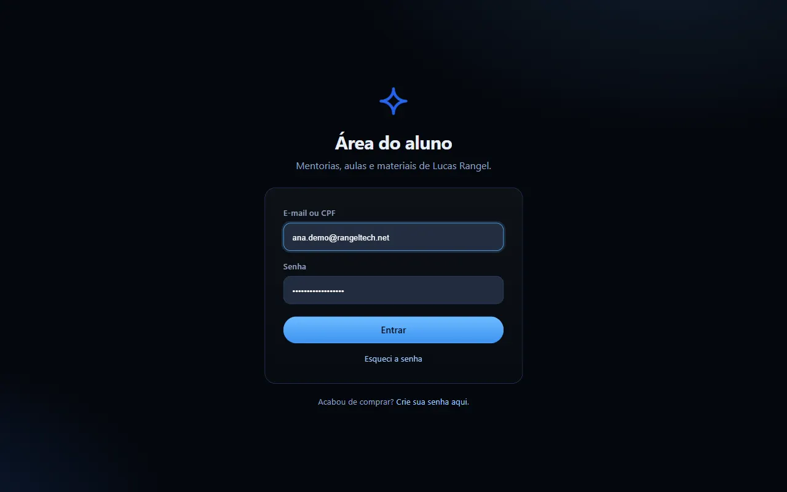

<!-- readme-padrao -->
# Área do aluno da mentoria

> Área do aluno da mentoria de Lucas Rangel: cursos, primeiro acesso, ciclo de vida (recuperação de carrinho e downsell) e webhook da Cakto.

## O que é
Área do aluno da mentoria de Lucas Rangel: cursos, primeiro acesso, ciclo de vida (recuperação de carrinho e downsell) e webhook da Cakto.

Estado: **no ar**.

## Onde está no ar
- https://user.rangeltech.net

## Onde faz o deploy
Este repositório **só publica** o artefato (release com imagem e manifesto); **quem implanta é o `vps_rt_infra`**.

- Serviço `ai-aluno`: `gh workflow run deploy.yml --repo RangelTech/vps_rt_infra -f service=ai-aluno` (só validar: `-f dry_run=true`; voltar versão: `-f version=<tag-antiga>`)
- Serviço `ai-aluno-turn`: `gh workflow run deploy.yml --repo RangelTech/vps_rt_infra -f service=ai-aluno-turn` (só validar: `-f dry_run=true`; voltar versão: `-f version=<tag-antiga>`)

Os `.env` desses serviços são gerados do Infisical no momento do deploy (spec 57, seção 0A).

## Como funciona por dentro
Resumo acima; os detalhes estão nas notas técnicas (README anterior) abaixo e na spec 57.

## Segredos
Nenhum valor de segredo fica neste repositório. Os segredos dos serviços ficam no Infisical (mapa em `vps_rt_infra/scripts/infisical/mapa_envs.json`) e chegam à VPS gerados no deploy.

## Rodar e testar localmente
Ver as notas técnicas abaixo (cada repositório tem o seu jeito); os testes de QA em produção são por cliques reais, com evidência em `new_ragente/qa/evidencias`.

## Links
- Repositório: https://github.com/RangelTech/ai_aluno
- Painel único: https://painel.rangeltech.net
- Spec de organização geral: `new_ragente/specs/57_ORGANIZACAO_GERAL_PRODUTOS_E_PAINEL.md`

## Notas técnicas (README anterior)

# ai_aluno: área do aluno (user.rangeltech.net)

Plataforma própria de Lucas Rangel (Rangel Tech): cursos em vídeo (HLS), downloads protegidos, mentorias ao vivo e gravações privadas.
Implementa o núcleo do MASTER_PLAN V3 (personal-skills/docs). Sem Cloudflare por enquanto: arquivos e vídeos ficam no volume `/data` do servidor.

- **Stack**: FastAPI + Jinja + SQLite (WAL) + ffmpeg. Sem CDN, sem script de terceiros. hls.js vendorizado.
- **Acesso**: sessão por cookie HttpOnly, bcrypt, CSRF, limite de tentativas; papéis admin/mentor/aluno; entitlements com origem, validade e auditoria.
- **Vídeo**: upload → ffmpeg → HLS 720p; a playlist e cada segmento revalidam sessão + acesso (403 sem direito, 401 sem login).
- **Mentorias**: agenda do admin, janela de entrada (10 min antes / 30 min depois, ajustável), sala WebRTC em malha até 5 pessoas, sinalização por WebSocket próprio, chat, compartilhamento de tela, consentimento de gravação registrado e gravações com grant por aluno.
- **Kiwify**: `POST /webhooks/kiwify?signature=` (HMAC-SHA1, idempotente). Ativa quando `KIWIFY_TOKEN` existir no ambiente.

## Ambiente
`MASTER_EMAIL`, `MASTER_PASSWORD_HASH` (bcrypt), `MASTER_NAME`, `DATA_DIR`, `ICE_SERVERS_JSON` (STUN/TURN; padrão STUN público), `KIWIFY_TOKEN`, `APP_TZ`.

## Pendências assumidas (ver docs do plano)
Gravação server-side (Jibri), R2 privado, TURN próprio, e-mails de lembrete, pagamento real. Hoje a gravação é enviada pelo admin depois da sessão.

## Release
Workflow `Release` (dispatch com versão) gera `image.tar.gz` + `release-manifest.json`; o deploy é só pelo `vps_rt_infra` (`service=ai-aluno`).

## v0.2.0

- Conquistas (medalhas, nível e pontos), certificado em PDF a partir de 80% do curso (com QR e página pública `/verificar/<código>`) e foto de perfil.
- Suporte no WhatsApp controlado pelo admin (`/admin/suporte`): o botão e o número só existem para quem tem direito (mentoria/acompanhamento). Produto Kiwify pode liberar o suporte.
- coturn próprio (`turn/`): STUN/TURN na VPS, com credenciais temporárias geradas pelo app (`TURN_SECRET`, `TURN_URLS`). Sem serviço de terceiros na sala.

## v2: quiz, agenda e prova (site de vendas v2)

Módulos novos em **Postgres** (banco `aluno` do Postgres central da VPS; o legado continua em SQLite): `app/pg.py`, `app/funil.py` (quiz de qualificação do site: `POST /api/quiz`, `PATCH /api/quiz/{token}`, `POST /api/quiz/{token}/concluir`, `GET /api/quiz/{token}`), `app/agenda.py` (calls de 30 min: `/agendar?t=`, `GET /api/agenda/horarios`, `POST /api/agenda/reservar`, `/agenda/{codigo}`, laço interno de lembretes e faltas, `POST /api/agenda/rodar`), `app/prova.py` (`GET /api/prova`: mapa, números, depoimentos e logos, sem a coluna `origem`). Painéis: `/admin/funil`, `/admin/agenda` (bloqueios, reservas, `.ics`), `/admin/prova` (importar JSON, ligar/desligar).

Variáveis novas: `DATABASE_URL` (ex.: `postgresql://aluno:<senha>@postgres:5432/aluno?sslmode=require`; sem ela as rotas novas respondem 503 e o resto segue), `SITE_URL` (padrão `https://ai.rangeltech.net`; única origem aceita no CORS), `SUPPORT_WHATSAPP` (padrão `5562985613482`). Com `CICLO_TESTE=1`, `?agora=` viaja no tempo em `/api/agenda/*` e o CORS também aceita `http://localhost:4321`.

Teste: `python scripts/e2e_funil.py <URL> <container>` (ver cabeçalho do script para a receita Docker).
